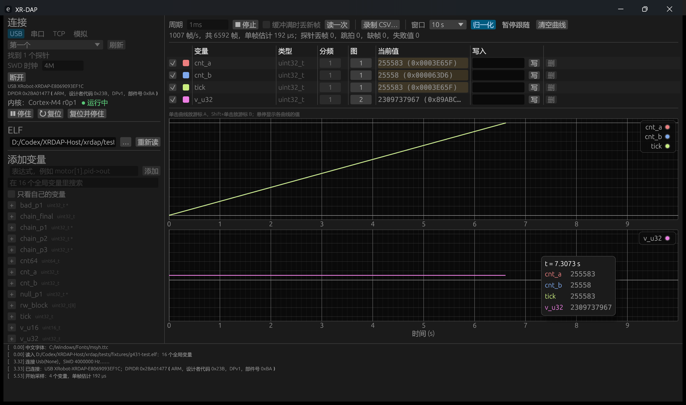

# XRDAP-Host

[中文](README.md)

`xrdap` is the host tool for the [XRDAP](https://github.com/Jiu-xiao/XRDAP-ESP) debug probes (ESP32-S3, ESP32-C3), for Windows and Linux. It is a single executable: double-clicking it or running it without arguments starts the GUI, and running it with a command works as a command-line tool.

What it does:

- Reads and writes target MCU memory by variable name, makes the probe sample variables at a fixed period, plots the curves in real time and exports CSV. Variable addresses and types come from the debug information in the ELF.
- Shares the probe with Keil, pyOCD, probe-rs and OpenOCD: a C3 on a USB cable can also be used as a standard USB probe.
- Halts, resumes and resets the target core; configures the probe's Wi-Fi.

To call it from your own program, use the Rust library [`xrdap`](xrdap/README.en.md).

## Download

Download the file for your platform from [Releases](../../releases), rename it to `xrdap` (`xrdap.exe` on Windows) and put it in PATH:

| Platform | File |
|---|---|
| Windows x86-64 | `xrdap-windows-x86_64.exe` |
| Linux x86-64 | `xrdap-linux-x86_64` |

Checksums are in `SHA256SUMS` on the same page. On Linux, the GUI needs a Chinese font on the system (Noto Sans CJK or WenQuanYi), otherwise Chinese text shows as boxes. A normal user needs a udev rule to access the USB probe:

```
SUBSYSTEM=="usb", ATTR{idVendor}=="1d50", ATTR{idProduct}=="6199", MODE="0666"
```

## Usage by scenario

Plug in the probe and run `xrdap list` once to check that it is found. The probe connection goes after `-p` (see "Selecting a probe (`-p`)"). With only one probe it can be left out.

### Plotting variables and changing parameters while the target runs

1. Run `xrdap` without arguments. In 找到的探针 (probes found) at the top left, click the row to use, then click 连接 (connect). The GUI shows the core model and run state.
2. In the ELF field, select the target program's ELF (built with `-g`).
3. Search for a variable name in the variable list and click `+` to add it to the watch table. An expression such as `motor[1].pid->out` can also be typed in the expression box, followed by 添加 (add). Structures and arrays are expanded into members.
4. Enter `1ms` in the period box and click 开始采样 (start sampling). The curves start scrolling.
5. Enter a value in the write box of the watch table and press Enter to change the variable. Click 录制 CSV… (record CSV…) to start recording.



The probe times the sampling, so the period is not limited by USB or Wi-Fi round-trip latency. If the period is shorter than the probe's estimated time per frame, the probe rejects it and the GUI switches to the suggested value. The curves can be split into 1 to 4 charts (linked time axis). Hovering shows the readings. A click and a Shift+click place the two cursors A and B. The connection, ELF, watch table and similar settings are saved on exit.

### Reading and writing variables from the command line, exporting CSV

```
xrdap --elf app.elf read motor.speed motor.state
xrdap --elf app.elf write motor.kp=1.5 mode=RUN
xrdap --elf app.elf watch motor.speed motor.current@10 --period 1ms --csv log.csv --duration 10
```

`read` reads once. `write` writes and reads back. `watch` makes the probe sample at the given period; `variable@10` means sampling once every 10 ticks, and without `--duration` it samples until Ctrl-C. Each row of `--csv` is one frame: host time, probe time, tick number, then one column per variable (a cell is empty when the variable is not due, and `ERR` when the read failed).

Variable syntax: `counter`, `state.speed`, `motor[1].pid->out`, `*ptr`, `p->q->x`, `(uint32_t***)p`, or a raw address `0x20000010:u32`.

### Debugging with Keil, pyOCD, probe-rs, OpenOCD

| How the probe is connected | What to do |
|---|---|
| S3 on USB | It is already a USB CMSIS-DAP probe; use it directly |
| C3 (or any XR-DAP) on USB / serial | Run `xrdap share usbip`, then attach with USB/IP, see below |
| Over Wi-Fi | The probe serves USB/IP itself; attach directly, see [XRDAP-ESP](https://github.com/Jiu-xiao/XRDAP-ESP/blob/main/README.en.md#23-over-wi-fi-with-keil-pyocd-probe-rs-openocd) |

To share a C3 plugged into the computer as a USB probe:

```
xrdap -p COM7 share usbip
```

Attach it in another terminal (on Linux prefix the command with `sudo` and run `sudo modprobe vhci-hcd` first; on Windows install [usbip-win2](https://github.com/vadimgrn/usbip-win2) first):

```
usbip attach -r 127.0.0.1 -b 1-1
```

`XR-DAP-C3 CMSIS-DAP` then appears in the system, and each tool uses it as a USB probe, for example:

```
openocd -f interface/cmsis-dap.cfg -f target/stm32f4x.cfg
```

Press Ctrl-C in the `xrdap` terminal to stop sharing; the debug tools see the probe as unplugged. In the GUI, connect to the probe and tick 共享为 USB DAP (share as USB DAP) for the same effect. Untick it to give the probe back to the GUI. To serve another computer on the LAN, add `--listen 0.0.0.0:3240`, and on that computer run `usbip attach -r <this machine's IP> -b 1-1`.

### Using a probe on a serial port with OpenOCD (without USB/IP)

```
xrdap -p COM7 share openocd
```

`xrdap` serves OpenOCD's CMSIS-DAP TCP backend on 127.0.0.1:3241 and prints the configuration OpenOCD needs:

```
openocd -c "adapter driver cmsis-dap; cmsis-dap backend tcp; cmsis-dap tcp host 127.0.0.1; cmsis-dap tcp port 3241; transport select swd" -f target/stm32f4x.cfg
```

The TCP backend is only in OpenOCD master. See "OpenOCD version".

### Configuring the probe's Wi-Fi

```
xrdap wifi set 热点名 密码
xrdap wifi status
xrdap wifi clear
```

Replace 热点名 (hotspot name) and 密码 (password) with the hotspot SSID and its password. After `set` and `clear`, the probe restarts in about 0.5 seconds. Once configured, `xrdap list` shows the probe's LAN address (`xrdap-xxxxxx.local`), and `-p xrdap-xxxxxx.local` can be used to work wirelessly from then on.

### Halting, resuming and resetting the target

```
xrdap halt
xrdap run
xrdap reset
xrdap reset --halt
```

`reset --halt` resets and stops before the first instruction. The GUI buttons 停住/继续 (halt/resume), 复位 (reset) and 复位并停住 (reset and halt) do the same, and they also work during sampling.

### Trying it without hardware

```
xrdap --fake info
xrdap --fake --elf app.elf read motor.speed
```

`--fake` uses a built-in simulated probe that fills memory from the ELF. In the GUI, choose 模拟 (simulated) as the connection.

## Reference

### Selecting a probe (`-p`)

| Form | Meaning |
|---|---|
| omitted | Uses the only USB probe if there is exactly one; otherwise searches USB, serial and the LAN and uses the only probe found |
| `usb`, `usb:<serial>` | USB |
| `COM7`, `/dev/ttyACM0` | Serial port. On the USB port built into Espressif chips, DTR/RTS are kept unchanged automatically |
| `192.168.0.108`, `xrdap-93ef1c.local`, `host:port` | Wi-Fi (OpenOCD TCP backend port 3241) |
| `XRobot-XRDAP-E8069093EF1C`, `93EF1C` | Full serial number or its last digits; searches USB first, then serial and the LAN |

`xrdap list` lists all probes, groups the connections of one probe together and shows the `-p` form for each.

### Commands

| Command | Action |
|---|---|
| (no command) | GUI |
| `list` | List probes on USB, serial and the LAN |
| `info [--no-target]` | Probe information (DAP_Info, vendor extension); connects to the target to read DPIDR and the core model |
| `vars [text]` | List global variables in the ELF |
| `read variable...` | Read variables |
| `write variable=value...` | Write variables and read back |
| `watch variable[@divider[:phase]]... [--period] [--csv] [--duration] [--no-overwrite] [--all]` | Probe-side periodic sampling |
| `halt`, `run`, `reset [--halt]` | Core control |
| `wifi status`, `wifi set ssid [password]`, `wifi clear` | Probe Wi-Fi |
| `share usbip [--listen]`, `share openocd [--listen]` | Share the probe with other debug tools |

Common options: `-p` probe, `--elf` ELF, `--clock` SWD clock (default 4M), `--baud` serial baud rate (default 4000000), `--keep-lines` leave DTR/RTS of the serial port unchanged, `--timeout-ms` response timeout, `--fake` simulated probe. `xrdap <command> -h` shows the full parameters of each command.

### USB/IP clients

| System | Install | Attach | Detach |
|---|---|---|---|
| Linux | In the kernel: `sudo modprobe vhci-hcd`; on Ubuntu the `usbip` command is in the `linux-tools-generic` package | `sudo usbip attach -r <address> -b 1-1` | `sudo usbip detach -p 0` |
| Windows | [usbip-win2](https://github.com/vadimgrn/usbip-win2) | `usbip attach -r <address> -b 1-1` | `usbip detach -p 0` |

Only one client is served at a time. After the debug tool that attached the device exits, the device stays attached; it is only removed by `usbip detach`. When sharing stops, the device is removed. If the client leaves while the probe is still sampling, `xrdap` stops the sampling for it.

### OpenOCD version

- When the probe is used over USB or USB/IP, OpenOCD uses its USB backend. The official release 0.12.0 is enough.
- `cmsis-dap backend tcp` (`share openocd` and direct Wi-Fi) is not in any official release (the latest, 0.12.0, came out in 2023). Build it from master. On Windows the build must include commit e89e73839d53 of 2026-08-15. Earlier master treats "no data yet" as an error on Windows, waits more than ten seconds at start-up and floods the log with `error reading header`.

### Building from source

```
cargo build --release -p xrdap-tool
```

This produces `target/release/xrdap`. On Linux, install `libgtk-3-dev libxkbcommon-dev libudev-dev` first.

| Directory | Content |
|---|---|
| `xrdap` | Rust library, see [xrdap/README.en.md](xrdap/README.en.md) |
| `xrdap-tool/src/cli` | Command line: connection options and commands |
| `xrdap-tool/src/gui` | GUI: background thread, panels, charts |

```
cargo test --workspace --all-features
```

The tests use an in-process simulated probe and need no hardware. They cover frame encoding and decoding, vendor commands, sampling, DWARF parsing, each command and sharing. CI also checks `cargo fmt` and `cargo clippy`.

## License

Apache-2.0, see [LICENSE](LICENSE).
