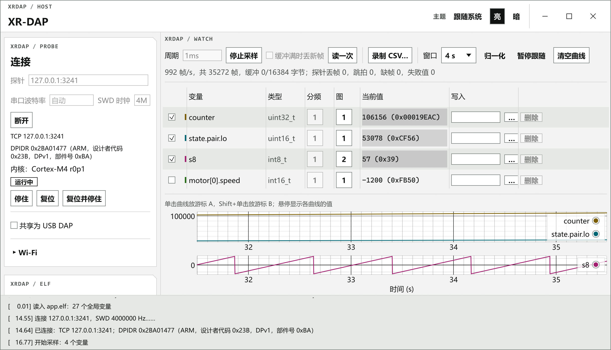
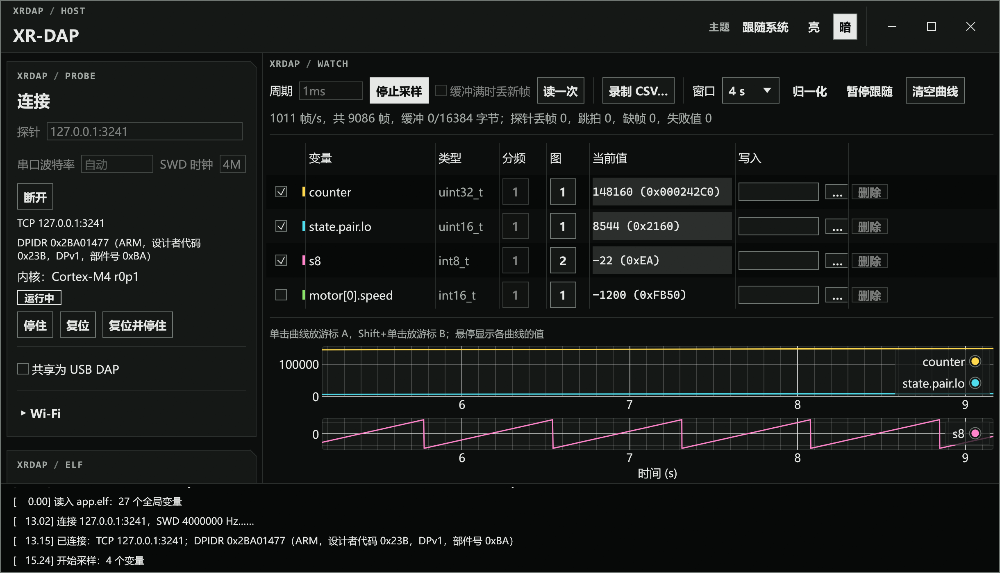

# XRDAP-Host

[中文](README.md)

XRDAP-Host is the host tool `xrdap` for the XR-DAP family of debug probes ([XRDAP-ESP](https://github.com/Jiu-xiao/XRDAP-ESP), [XRDAP-F103C8](https://github.com/Jiu-xiao/XRDAP-F103C8), [XRDAP-CH32](https://github.com/Jiu-xiao/XRDAP-CH32)), for Windows and Linux. `xrdap` reads and writes target MCU memory by variable name, has the probe sample variables at a fixed period, plots them live and exports CSV; variable addresses and types come from the debug information in the ELF. It also shares the probe with Keil, pyOCD, probe-rs and OpenOCD, controls the target core and configures the probe's Wi-Fi. The tool is a single executable: run without arguments it opens the GUI, run with a command it works as a command-line tool.

An introduction video of the XR-DAP family is on [YouTube](https://youtu.be/H6S_sdkS8vs).

The same functions are available to other programs as the Rust library `xrdap`, see [xrdap/README.en.md](xrdap/README.en.md). The protocol between probe and host is XRDAP-Core's [`docs/protocol.en.md`](https://github.com/Jiu-xiao/XRDAP-Core/blob/main/docs/protocol.en.md); `xrdap` uses protocol version 2 of its XR vendor extension and asks for a firmware update when the probe firmware reports another version.

## Download

[Releases](https://github.com/Jiu-xiao/XRDAP-Host/releases) has one file per platform: `xrdap-windows-x86_64.exe` for Windows x86-64 and `xrdap-linux-x86_64` for Linux x86-64; `SHA256SUMS` on the same page holds their checksums. The file is renamed to `xrdap` (`xrdap.exe` on Windows) and put on `PATH`; the commands below call it by this name.

`xrdap` prints in Chinese in a Chinese environment and in English elsewhere; `XR_LANG=en` selects English, see [docs/cli.en.md](docs/cli.en.md). On Linux the GUI shows Chinese text, such as the Chinese interface or Chinese names in the ELF, with the system's Noto Sans CJK or WenQuanYi Micro Hei, one of which has to be installed for it. With this udev rule ordinary users can access USB probes:

```
SUBSYSTEM=="usb", ATTR{idVendor}=="1d50", ATTR{idProduct}=="6199", MODE="0666"
```

## Choosing a probe

Commands that connect a probe take it with `-p`: the serial number or its last digits, `usb`, a serial port name (`COM3`, `/dev/ttyUSB0`), an IP address, or a LAN host name such as `xrdap-aabbcc.local`; with only one probe it can be omitted. `xrdap list` lists the probes on USB and on the LAN, the USB port built into Espressif chips (USB Serial/JTAG of the ESP32-C3), and the `-p` form of each connection; other serial ports are listed by name only, and `--ask-serial` opens and asks each of them.

```
xrdap list
xrdap info -p COM3
```

Every `-p` form, the choice of serial baud rate and the rule that one connection at a time uses the probe are in [docs/cli.en.md](docs/cli.en.md#probes).

## GUI

Running `xrdap` without arguments, or double-clicking it on Windows, opens the GUI. The left column holds the connection, the ELF and adding variables: Found probes lists the connections of each probe and the other serial ports, a click on a row fills it into the Probe field, and after Connect the GUI shows the core type and its run state; the ELF (built with `-g`) is read in the background, and variables are added from a searchable list or as an expression such as `motor[1].pid->out`, with structs and arrays expanded into their members.

On the right, from top to bottom, are the sampling controls, the watch table and the plots. With the Period filled in, Start sampling starts the plot scrolling; in the watch table each variable gets its divider and its chart, and a value typed into the Write column and Enter changes the variable. The plots can be split across up to 4 charts with linked time axes; click and Shift+click place cursors A and B. Record CSV… writes the samples to a CSV file. The statistics line shows the frame count and the sampling counters, with advice below it when sampling cannot keep its period. The probe, the ELF, the watch table and other settings are saved on exit, and Theme in the top bar follows the system or stays light or dark.





The screenshots are connected to the simulated probe served by `cargo run -p xrdap-sim --example serve -- app.elf counter state.pair.lo s8`.

## Reading, writing and sampling on the command line

`vars` lists the variables in the ELF, `read` reads variables, `write` writes and reads back, and `watch` has the probe sample at a fixed period and prints the result or writes it to CSV. The probe times the sampling, so the period does not depend on USB or Wi-Fi round trips.

```
xrdap vars --elf app.elf motor
xrdap read --elf app.elf motor.speed motor.state
xrdap write --elf app.elf motor.kp=1.5 mode=RUN
xrdap watch --elf app.elf motor.speed motor.current@10 --period 1ms --csv log.csv --duration 10
```

`motor.current@10` samples every 10th tick. The syntax of variables and values, the options of `watch`, the CSV columns and the counters that show whether sampling keeps its period are in [docs/cli.en.md](docs/cli.en.md#sampling).

## Use with other debug tools

ESP32-S3, ESP32-S2, STM32F103, CH32V307, CH32V305 and CH32V208 (`linkw`, WCH-LinkW-R0-1v1) probes on USB are USB CMSIS-DAP probes themselves, and Keil, pyOCD, probe-rs and OpenOCD use them directly. CH32 wireless probes (two `wdap` or two `linkw`) are used in pairs; they are paired with a key on the probes, as the [XRDAP-CH32](https://github.com/Jiu-xiao/XRDAP-CH32) documentation describes.

A probe on a serial port (ESP32-C3, classic ESP32 and others) or on Wi-Fi is shared as a USB/IP device with `xrdap share usbip`. `xrdap` prints the attach command; once a USB/IP client runs it in another terminal, a `<product> CMSIS-DAP` device appears and debug tools use it as a USB probe. Ctrl-C in the `xrdap` terminal stops sharing. The Share as USB DAP switch in the GUI does the same.

```
xrdap share usbip -p COM3
```

OpenOCD can also use the CMSIS-DAP TCP backend. A Wi-Fi probe serves this backend on port 3241 itself, and OpenOCD connects to the probe's address; for a probe on a serial port `xrdap share openocd` serves it on port 3241 of this computer, and OpenOCD is started in another terminal:

```
xrdap share openocd -p COM3
openocd -c "adapter driver cmsis-dap; cmsis-dap backend tcp; cmsis-dap tcp host 127.0.0.1; cmsis-dap tcp port 3241; transport select swd" -f target/stm32f4x.cfg
```

Installing a USB/IP client, sharing with other computers on the LAN, what happens when a client disconnects, and the OpenOCD versions with the TCP backend are in [docs/cli.en.md](docs/cli.en.md#use-with-other-debug-tools). The use of Wi-Fi probes is described in [XRDAP-ESP](https://github.com/Jiu-xiao/XRDAP-ESP).

## Configuring the probe's Wi-Fi

An XRDAP-ESP probe joins an existing hotspot as a Wi-Fi client. `xrdap wifi` queries, saves and clears the hotspot credentials on the probe, and the probe restarts after a save or a clear:

```
xrdap wifi status -p COM3
xrdap wifi set -p COM3 SSID PASSWORD
```

`xrdap wifi clear` clears the credentials. Once the probe is on the hotspot, `xrdap list` shows its LAN address `xrdap-xxxxxx.local`, and `-p xrdap-xxxxxx.local` connects over Wi-Fi. Wi-Fi at the bottom of the connection area in the GUI does the same. The status fields and `--password-stdin`, which reads the password from standard input, are in [docs/cli.en.md](docs/cli.en.md#wi-fi).

## Controlling the target

`info` shows the probe information and connects the target to read DPIDR and the core type; `halt`, `run` and `reset` halt, resume and reset the target's Cortex-M core, and `reset --halt` stops before the first instruction after reset. The GUI buttons Halt, Resume, Reset and Reset and halt do the same and also work while sampling.

```
xrdap info
xrdap halt
xrdap run
xrdap reset --halt
```

## Building and testing

Building needs the Rust stable toolchain, and on Linux also `libgtk-3-dev`, `libxkbcommon-dev` and `libudev-dev`:

```
cargo build --release -p xrdap-tool
cargo test --workspace
```

The executable is `target/release/xrdap`. The tests need no hardware: `xrdap-sim` simulates the probe and the target from the CMSIS-DAP specification and the protocol document and serves the probe's framing over TCP; the tests cover framing, vendor commands, the control port, sampling and compact frames, DWARF parsing, every command and sharing. CI builds and tests on Windows and Linux, checks `cargo fmt` and `cargo clippy`, and publishes a release when a `v*` tag is pushed.

## Directories

| Directory | Contents |
|---|---|
| `xrdap/` | The Rust library `xrdap`: transports, protocol, variable resolution, sampling, sharing; see [xrdap/README.en.md](xrdap/README.en.md) |
| `xrdap-tool/src/cli/` | Command line: option groups and commands |
| `xrdap-tool/src/gui/` | GUI: worker thread, panels, plots, theme |
| `xrdap-tool/tests/` | Tests that run every command against the simulated probe |
| `xrdap-sim/` | The probe simulator for tests; `examples/serve.rs` serves a simulated probe on this computer |
| `docs/` | The command-line reference `cli.en.md` and the GUI screenshots |

## License

Apache-2.0, see [LICENSE](LICENSE).
