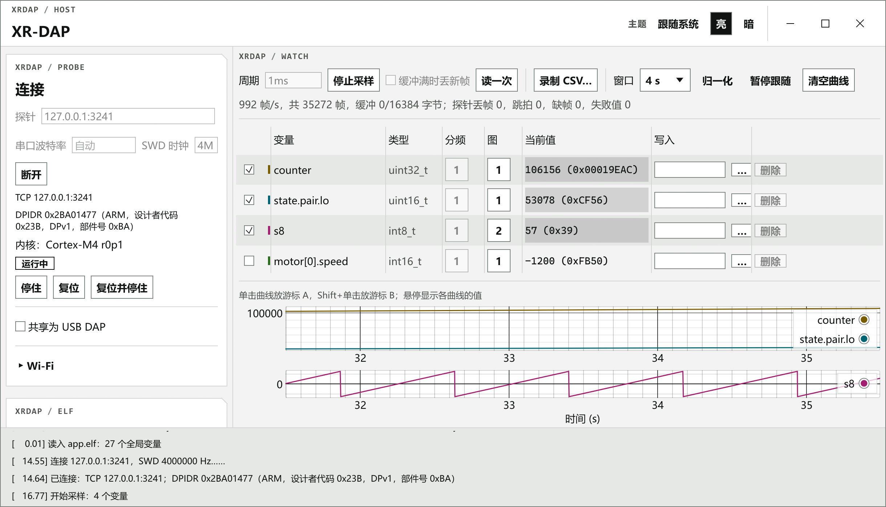
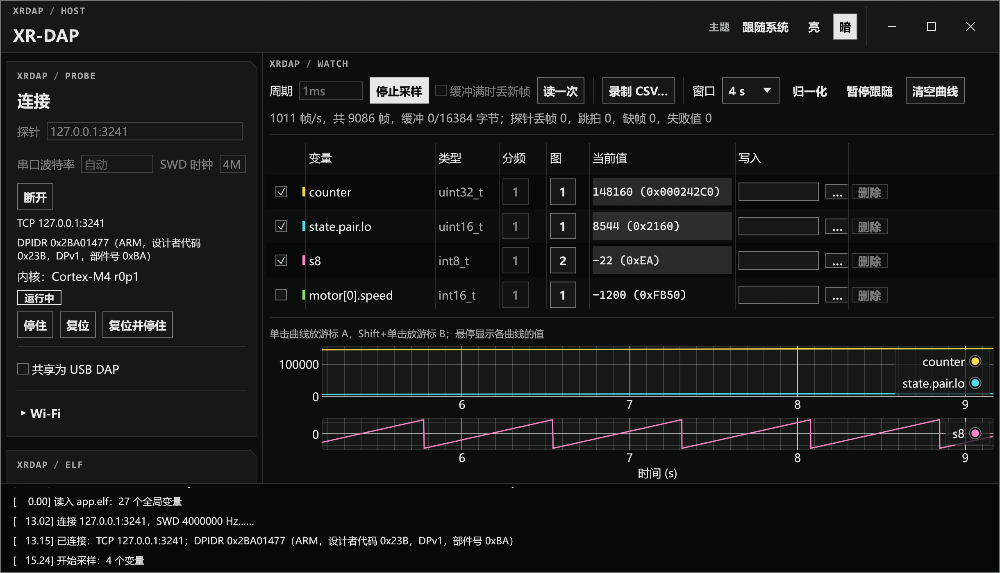

# XRDAP-Host

[English](README.en.md)

XRDAP-Host 是 XR-DAP 系列调试探针（[XRDAP-ESP](https://github.com/Jiu-xiao/XRDAP-ESP)、[XRDAP-F103C8](https://github.com/Jiu-xiao/XRDAP-F103C8)、[XRDAP-CH32](https://github.com/Jiu-xiao/XRDAP-CH32)）的电脑端工具 `xrdap`，支持 Windows 和 Linux。`xrdap` 按变量名读写目标 MCU 的内存，让探针按固定周期采样变量，实时绘制曲线并导出 CSV，变量的地址和类型取自 ELF 中的调试信息；它还把探针共享给 Keil、pyOCD、probe-rs 和 OpenOCD，控制目标内核，配置探针的 Wi-Fi。工具是一个可执行文件：不带参数运行时打开图形界面，带命令运行时作为命令行工具。

XR-DAP 系列的介绍视频见 [Bilibili](https://www.bilibili.com/video/BV17oWx6YEde/)。

这些功能也以 Rust 库 `xrdap` 的形式提供给其他程序调用，见 [xrdap/README.md](xrdap/README.md)。探针与电脑之间的协议见 XRDAP-Core 的 [`docs/protocol.md`](https://github.com/Jiu-xiao/XRDAP-Core/blob/main/docs/protocol.md)；`xrdap` 使用其中协议版本 2 的 XR 厂商扩展，探针固件报告其他版本时提示升级固件。

## 下载

在 [Releases](https://github.com/Jiu-xiao/XRDAP-Host/releases) 下载对应平台的文件：Windows x86-64 为 `xrdap-windows-x86_64.exe`，Linux x86-64 为 `xrdap-linux-x86_64`，同一页的 `SHA256SUMS` 是它们的校验和。文件改名为 `xrdap`（Windows 上为 `xrdap.exe`）并放入 `PATH`，下文的命令以这个名字调用。

Linux 上的图形界面用系统中的 Noto Sans CJK 或文泉驿微米黑显示中文，需要安装其中一种。加入以下 udev 规则后，普通用户可以访问 USB 探针：

```
SUBSYSTEM=="usb", ATTR{idVendor}=="1d50", ATTR{idProduct}=="6199", MODE="0666"
```

## 选择探针

连接探针的命令用 `-p` 指定探针，可以写序列号或它的末尾几位、`usb`、串口名（`COM3`、`/dev/ttyUSB0`）、IP 地址，或 `xrdap-aabbcc.local` 这样的局域网主机名；只有一块探针时可以省略。`xrdap list` 列出 USB 和局域网上的探针、乐鑫芯片自带的 USB 口（ESP32-C3 的 USB Serial/JTAG），以及每条连接对应的 `-p` 写法；其他串口只列出名字，加 `--ask-serial` 时逐个打开询问。

```
xrdap list
xrdap info -p COM3
```

`-p` 的全部写法、串口波特率的选择，以及探针同一时间只由一条连接使用的规则见 [docs/cli.md](docs/cli.md#探针)。

## 图形界面

不带参数运行 `xrdap`，或在 Windows 上双击它，打开图形界面。左栏是连接、ELF 和添加变量：“找到的探针”列出各块探针的连接和其他串口，点选一行把它填入“探针”一栏，点“连接”后界面显示内核型号和运行状态；ELF（编译时带 `-g`）在后台读取，变量从列表中搜索后添加，或写成 `motor[1].pid->out` 这样的表达式添加，结构体和数组展开为成员。

右侧从上到下是采样控制、监视表和曲线。填好“周期”后点“开始采样”，曲线随采样滚动；监视表中可以设置每个变量的分频和所在的图，在“写入”一栏填值并按回车修改变量。曲线最多分在 4 张图上，时间轴联动，单击和 Shift+单击放置游标 A、B。“录制 CSV…”把采样写入 CSV 文件。统计行显示帧数和采样计数器，采样不能按周期完成时下方给出建议。探针、ELF、监视表等设置在退出时保存，顶栏的“主题”可以选择跟随系统、亮或暗。





截图连接的是 `cargo run -p xrdap-sim --example serve -- app.elf counter state.pair.lo s8` 提供的模拟探针。

## 命令行读写与采样

`vars` 列出 ELF 中的变量，`read` 读变量，`write` 写入后读回，`watch` 让探针按固定周期采样，结果打印到终端或写入 CSV。采样由探针定时，周期不受 USB 或 Wi-Fi 往返延迟的影响。

```
xrdap vars --elf app.elf motor
xrdap read --elf app.elf motor.speed motor.state
xrdap write --elf app.elf motor.kp=1.5 mode=RUN
xrdap watch --elf app.elf motor.speed motor.current@10 --period 1ms --csv log.csv --duration 10
```

`motor.current@10` 表示每 10 拍采一次。变量和值的写法、`watch` 的选项、CSV 的各列，以及判断采样能否按周期完成的计数器见 [docs/cli.md](docs/cli.md#采样)。

## 给其他调试工具使用

插在 USB 上的 ESP32-S3、ESP32-S2、STM32F103、CH32V307、CH32V305、CH32V208（`linkw`，WCH-LinkW-R0-1v1）探针本身是 USB CMSIS-DAP 探针，Keil、pyOCD、probe-rs、OpenOCD 直接使用。CH32 的无线探针（两块 `wdap` 或两块 `linkw`）成对使用，配对在探针上用按键完成，方法见 [XRDAP-CH32](https://github.com/Jiu-xiao/XRDAP-CH32) 的文档。

经串口（ESP32-C3、传统 ESP32 等）或 Wi-Fi 连接的探针由 `xrdap share usbip` 共享为 USB/IP 设备。`xrdap` 打印挂载命令，在另一个终端用 USB/IP 客户端执行后，系统中出现 `<产品名> CMSIS-DAP` 设备，各调试工具把它当作 USB 探针使用；在 `xrdap` 的终端按 Ctrl-C 停止共享。图形界面中的“共享为 USB DAP”开关作用相同。

```
xrdap share usbip -p COM3
```

OpenOCD 还可以使用 CMSIS-DAP 的 TCP 后端。Wi-Fi 探针自己在 3241 端口提供这个后端，OpenOCD 直接连接探针的地址；串口上的探针由 `xrdap share openocd` 在本机 3241 端口提供，OpenOCD 在另一个终端中启动：

```
xrdap share openocd -p COM3
openocd -c "adapter driver cmsis-dap; cmsis-dap backend tcp; cmsis-dap tcp host 127.0.0.1; cmsis-dap tcp port 3241; transport select swd" -f target/stm32f4x.cfg
```

USB/IP 客户端的安装、给局域网中其他电脑共享、客户端断开时的处理，以及支持 TCP 后端的 OpenOCD 版本见 [docs/cli.md](docs/cli.md#给其他调试工具使用)。Wi-Fi 探针的用法见 [XRDAP-ESP](https://github.com/Jiu-xiao/XRDAP-ESP)。

## 配置探针的 Wi-Fi

XRDAP-ESP 探针作为 Wi-Fi 客户端连接已有的热点。`xrdap wifi` 查询、保存和清除探针中的热点参数，保存或清除后探针重启：

```
xrdap wifi status -p COM3
xrdap wifi set -p COM3 热点名 密码
```

`xrdap wifi clear` 清除热点参数。探针连上热点后，`xrdap list` 列出它的局域网地址 `xrdap-xxxxxx.local`，之后用 `-p xrdap-xxxxxx.local` 经 Wi-Fi 连接。图形界面中连接区最下方的“Wi-Fi”一栏作用相同。状态的各项和从标准输入读取密码的 `--password-stdin` 见 [docs/cli.md](docs/cli.md#wi-fi)。

## 控制目标

`info` 显示探针信息，并连接目标读出 DPIDR 和内核型号；`halt`、`run`、`reset` 停住、继续、复位目标的 Cortex-M 内核，`reset --halt` 复位后停在第一条指令之前。图形界面中的“停住”“继续”“复位”“复位并停住”按钮作用相同，采样期间也可以使用。

```
xrdap info
xrdap halt
xrdap run
xrdap reset --halt
```

## 编译和测试

编译需要 Rust stable 工具链，Linux 上另需 `libgtk-3-dev`、`libxkbcommon-dev` 和 `libudev-dev`：

```
cargo build --release -p xrdap-tool
cargo test --workspace
```

可执行文件生成在 `target/release/xrdap`。测试不需要硬件：`xrdap-sim` 依据 CMSIS-DAP 规范和协议文档模拟探针与目标，经 TCP 提供与探针相同的帧格式；测试覆盖帧编解码、厂商命令、控制口、采样和紧凑帧、DWARF 解析、各个命令和共享。CI 在 Windows 和 Linux 上编译、测试并检查 `cargo fmt` 和 `cargo clippy`，推送 `v*` 标签时发布 Release。

## 目录

| 目录 | 内容 |
|---|---|
| `xrdap/` | Rust 库 `xrdap`：传输、协议、变量解析、采样、共享，见 [xrdap/README.md](xrdap/README.md) |
| `xrdap-tool/src/cli/` | 命令行：选项组和各命令 |
| `xrdap-tool/src/gui/` | 图形界面：后台线程、各面板、曲线、主题 |
| `xrdap-tool/tests/` | 对模拟探针运行各个命令的测试 |
| `xrdap-sim/` | 测试用的探针模拟器；`examples/serve.rs` 在本机提供一个模拟探针 |
| `docs/` | 命令行参考 `cli.md` 和界面截图 |

## 许可证

Apache-2.0，见 [LICENSE](LICENSE)。
